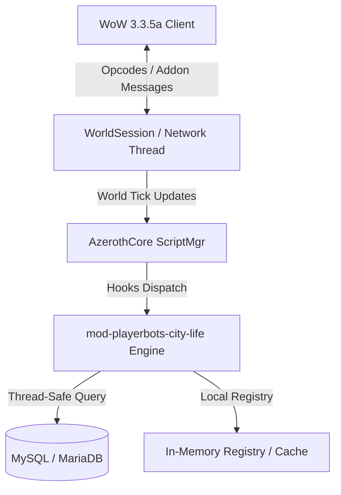

# Architecture Specification: `mod-playerbots-city-life`

## 1. System Overview
`mod-playerbots-city-life` (Playerbots City Life & Ambient Roleplay) is an AzerothCore modular extension designed to enhance the WotLK 3.3.5a engine.

### Functional Summary
Populates major capital cities with autonomous playerbots walking realistic schedules, visiting taverns, and browsing shops.

---

## 2. Subsystem Structure & Component Interactions

### Key Components
1. **Script Registration**: Hooks into AzerothCore via `ScriptMgr` loaders (`PlayerScript`, `CreatureScript`, `WorldScript`, `GossipScript`).
2. **Configuration Subsystem**: Loads module settings from `conf/mod-playerbots-city-life.conf.dist` during `WorldScript::OnConfigLoad`.
3. **Data Layer**: Persistent state stored in MySQL `characters` or `world` tables, with RAM caching for fast per-tick evaluation.

---

## 3. Threading & Concurrency Model
- **World Loop Execution**: All entity evaluations take place on the single-threaded world tick. Zero blocking I/O is permitted.
- **Asynchronous Execution**: Worker tasks or database writes utilize asynchronous query callbacks (`CharacterDatabase.AsyncQuery` or dedicated worker threads).
- **Concurrency Protection**: Shared state across player sessions is protected using RAII locks (`std::mutex`, `std::recursive_mutex`).

---

## 4. Architectural Invariants
- Pathfinding routes inside cities must use standard ACore mmaps without falling through terrain.
- City life behaviors must disengage instantly if the bot is invited to a party or commanded by an owner.
- CPU usage must be strictly throttled when large numbers of ambient bots occupy the same cell.
