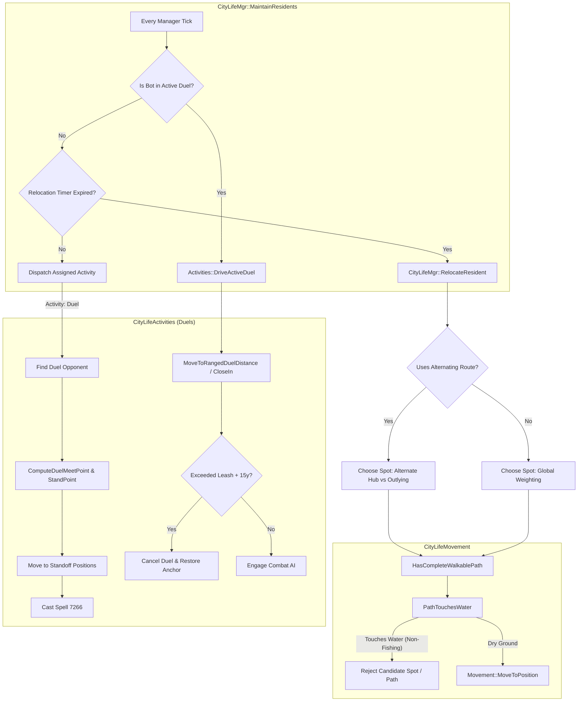

# Implementation Plan: Advanced Micro-Behaviors Integration

**Module**: `mod-playerbots-city-life`  
**Target Release**: High-Fidelity Ambient Micro-Behaviors Upgrade  
**Author**: Antigravity Assistant  
**Date**: October 10, 2026  
**Status**: DRAFT (Pending Review & Feedback)

---

## 1. Executive Summary & Purpose

The baseline integration between `mod-city-bots` and `mod-playerbots-city-life` successfully unified living crowd scenes, paired duels, dock fishing, inn dancing, dynamic population budgeting, and curated POIs.

To achieve **100% fine-grained behavioral parity** with `mod-city-bots/src/CbStrategyGate.cpp`, this plan specifies the porting and adaptation of four advanced micro-behaviors:

1. **Alternating District Visits (`UsesAlternatingHubRoute`)**: Bots alternate between primary commercial squares (e.g. Trade District, Valley of Strength) and outlying quarters (Old Town, Mage Quarter, The Drag, Valley of Honor), creating realistic city-wide circulation instead of perpetual clustering at bank/auction house steps.
2. **Duel Meeting-Point Rendezvous (`ComputeDuelMeetPoint` & `ComputeDuelStandPoint`)**: Duel participants establish a mutual meeting point halfway between their positions and separate to standoff distances before casting the challenge spell, mirroring authentic player dueling etiquette.
3. **Tactical Duel Range-Keeping (`MoveToRangedDuelDistance` & `DriveActiveDuel`)**: During active duels, ranged classes (Hunters, Mages, Warlocks, Priests) dynamically backpedal/kite to 11–20 yd, while melee classes close to $\le 5$ yd, strictly constrained within the duel ring leash radius.
4. **Canal Water Avoidance (`PathTouchesWater` & `HasCompleteWalkablePath`)**: Navmesh paths are sampled at both waypoints and segment midpoints against AzerothCore's `map->IsInWater()` to eliminate underwater plunges into Stormwind canals or Undercity slime moats during roaming.

---

## 2. Architecture & Subsystem Integration



---

## 3. Detailed Micro-Behavior Specifications

### 3.1. Alternating District Visits (`UsesAlternatingHubRoute`)

#### Problem Statement
In major capitals like Stormwind and Orgrimmar, high POI weights at banks and auction houses cause bots to concentrate indefinitely in the primary commercial square. Even during periodic relocations, bots frequently hop between two adjacent bank spots or stay within the same district, leaving surrounding quarters depopulated.

#### Solution Architecture
- In `Resident`, maintain a persistent flag: `bool LastRoamWasHub = false;`.
- When a relocation occurs, if the hub qualifies under `UsesAlternatingHubRoute(hub.Name)`:
  - If `LastRoamWasHub == true`, the selection filter queries for spots in **outlying districts** (`IsOutlyingDistrict`).
  - If `LastRoamWasHub == false`, the selection filter queries for spots in the **central commercial district** (`IsHubDistrict`).
  - After assigning the spot, update `resident.LastRoamWasHub = IsHubDistrict(hub.Name, spot->District)`.
  - If no spots match the filter in an outlying district, fall back gracefully to the standard weighted selection.

#### District Classification Matrix
| Hub | Central Hub District (`IsHubDistrict`) | Outlying Districts (`IsOutlyingDistrict`) |
| :--- | :--- | :--- |
| **Stormwind** | `TradeDistrict`, `Trade` | `OldTown`, `DwarvenDistrict`, `MageQuarter`, `CathedralSquare`, `Canals` |
| **Orgrimmar** | `ValleyOfStrength`, `ValleyInn`, `ValleyMarket`, `Valley` | `TheDrag`, `Drag`, `ValleyOfHonor`, `Honor`, `ValleyOfSpirits`, `ValleyOfWisdom`, `CleftOfShadow`, `Cleft` |
| **Ironforge** | `GreatForge`, `Commons` | `MilitaryWard`, `MysticWard`, `TinkerTown` |
| **Undercity** | `MagicQuarter`, `Apothecarium` | `RoguesQuarter`, `WarQuarter`, `Canals` |
| **Darnassus** | `Craftsmen`, `TradesmensTerrace` | `TempleGardens`, `WarriorTerrace` |
| **Dalaran** | `MagusCommerce`, `CentralLoop` | `Eventide`, `Sunreaver`, `SilverEnclave`, `PurpleParlor`, `Sewers` |
| **Thunder Bluff** | `LowerRise`, `Central` | `ElderRise`, `HunterRise`, `SpiritRise` |
| **Silvermoon** | `Bazaar`, `SunfurySpire` | `MurderRow`, `Walkers`, `Farstriders` |
| **Exodar** | `SeatOfNaaru` | `CrystalHall`, `TradersTier`, `VaultOfLights` |
| **Shattrath** | `Terrace`, `CentralTerrace` | `AldorRise`, `ScryersTier`, `LowerCity` |

---

### 3.2. Duel Meeting-Point Rendezvous (`ComputeDuelMeetPoint` & `ComputeDuelStandPoint`)

#### Problem Statement
Currently, `ExecuteDuel` has the initiator bot walk directly into the opponent's coordinates and immediately cast Spell 7266 when within 10 yd, while the opponent remains motionless. Real players meet halfway in the arena/gate space, orient toward each other at appropriate distances, and only then accept or challenge.

#### Algorithmic Formulation

```text
Challenger Bot (A) -----------------> [ Meet Point (M) ] <----------------- Opponent Bot (B)
                                     /                 \
                          Stand A <-                     -> Stand B
                         (offset 2.4y/4.8y)             (offset 2.4y/4.8y)
```

1. **Midpoint Calculation**:
   $$\mathbf{M} = \frac{\mathbf{P}_A + \mathbf{P}_B}{2} = \left(\frac{X_A + X_B}{2}, \frac{Y_A + Y_B}{2}, \frac{Z_A + Z_B}{2}\right)$$
2. **Leash Clamping to Anchor Ring**:
   Given anchor spot $\mathbf{A}_{ring} = (X_{ring}, Y_{ring})$ and leash radius $R_{leash}$:
   $$D = \|\mathbf{M}_{xy} - \mathbf{A}_{ring}\|$$
   $$\text{If } D > R_{leash}: \quad \mathbf{M}_{xy} = \mathbf{A}_{ring} + \frac{\mathbf{M}_{xy} - \mathbf{A}_{ring}}{D} \times R_{leash}$$
   Height is projected onto the navmesh via `bot->UpdateAllowedPositionZ(M.x, M.y, M.z)`.
3. **Standoff Separation (`ComputeDuelStandPoint`)**:
   - Determine separation distance $d_{sep}$:
     - If `IsRangedDueler(bot)`: $d_{sep} = 4.8\text{ yd}$
     - If `IsMeleeDueler(bot)`: $d_{sep} = 2.4\text{ yd}$
   - Normal vector $\vec{n} = (-(Y_B - Y_A), X_B - X_A)$ perpendicular to the line between duelists.
   - Side factor $s = +1$ if $\text{GUID}_A < \text{GUID}_B$, else $-1$.
   - Compute standoff coordinate:
     $$\mathbf{S}_A = \mathbf{M}_{xy} + s \cdot d_{sep} \cdot \frac{\vec{n}}{\|\vec{n}\|}$$
     Project height with `bot->UpdateAllowedPositionZ(S_A.x, S_A.y, S_A.z)`.
4. **State Machine Flow**:
   - Both bots enter `DuelState::Rendezvous`.
   - Bot A and Bot B move to $\mathbf{S}_A$ and $\mathbf{S}_B$ using `Movement::MoveToPosition`.
   - Timeout guard: 15 seconds. If either bot is obstructed or fails to reach $\le 2.0\text{ yd}$ of $\mathbf{S}$, reset state.
   - Once both arrive, Challenger casts Spell 7266.

---

### 3.3. Tactical Duel Range-Keeping (`MoveToRangedDuelDistance` & `DriveActiveDuel`)

#### Problem Statement
In AzerothCore, when `player->duel` is active, native bot combat AI takes control of abilities. However, native combat movement frequently rushes into point-blank melee (even for Hunters and Mages) or strays hundreds of yards away chasing an opponent. City duels should maintain tactical spacing and respect the arena boundaries.

#### Behavioral Rules
- **Class / Spec Identification**:
  - `IsRangedDueler(bot)`: Hunters, Mages, Warlocks, Priests, Balance Druids, Elemental Shamans.
  - `IsMeleeDueler(bot)`: Warriors, Rogues, Death Knights, Retribution/Protection Paladins, Feral Druids, Enhancement Shamans.
- **Ranged Kiting & Spacing Logic**:
  - If `IsRangedDueler(bot)` and currently not casting a non-melee spell:
    - Distance to opponent $D = \text{bot}->\text{GetDistance}(\text{opponent})$.
    - If $D < 11.0\text{ yd}$ (inside deadzone or melee threat):
      - Retreat vector: $\vec{v} = \mathbf{P}_{bot} - \mathbf{P}_{opp}$.
      - Target position: $\mathbf{P}_{target} = \mathbf{P}_{opp} + \frac{\vec{v}}{\|\vec{v}\|} \times D_{preferred}$
        where $D_{preferred} = 16.0\text{ yd}$ for Hunters and $14.0\text{ yd}$ for spellcasters.
      - Clamp $\mathbf{P}_{target}$ inside duel ring leash ($R_{leash} = 40.0\text{ yd}$).
      - Issue movement: `bot->GetMotionMaster()->MovePoint(0, targetX, targetY, targetZ)`.
    - If $D > 20.0\text{ yd}$ and out of casting range:
      - Close distance slightly back to $D_{preferred}$.
- **Melee Closing Logic**:
  - If `IsMeleeDueler(bot)` and $D > 5.5\text{ yd}$ and not casting:
    - Move toward opponent: `bot->GetMotionMaster()->MovePoint(0, oppX, oppY, oppZ)`.
- **Ring Boundary & Stagnation Leash**:
  - Check distance from duel anchor: if either duelist exceeds $\text{leashRadius} + 15.0\text{ yd}$, or duels stay out of LOS for $>8\text{ s}$, cancel duel via `CancelCityDuel(bot)` and restore participants.
- **Throttling**:
  - Movement updates during duels are throttled with a 1000ms cooldown to eliminate twitching and excessive navmesh recalculations.

---

### 3.4. Canal Water Avoidance (`PathTouchesWater` & `HasCompleteWalkablePath`)

#### Problem Statement
In cities featuring waterways (Stormwind canals, Undercity sewer channels, Ironforge lava/water moats), straight-line or navmesh paths often cut corners over water bodies. When bots take these paths, they plunge into the water, triggering sink forensics warnings, swimming endlessly, or failing to dismount.

#### Navmesh Verification Algorithm
1. **Instantiate PathGenerator**:
   ```cpp
   PathGenerator path(bot);
   if (!path.CalculatePath(targetX, targetY, targetZ, false))
       return false;
   ```
2. **Path Type Validation**:
   - Reject paths with `PATHFIND_NOPATH`, `PATHFIND_SHORTCUT`, or `PATHFIND_NOT_USING_PATH`.
   - If `PATHFIND_INCOMPLETE`:
     - Inspect straight tail distance: if $\|\text{ActualEnd} - \mathbf{P}_{target}\| > 15.0\text{ yd}$, reject.
     - Sample 8 radial points in a 5.0 yd ring around the endpoint: if any point is in water, reject.
3. **Midpoint Navmesh Sampling (`PathTouchesWater`)**:
   - Query map water status: `map->IsInWater(phaseMask, p.x, p.y, p.z, collisionHeight)`.
   - **Waypoint check**: For each point $\mathbf{p}_i \in \text{path}$, verify `!map->IsInWater(...)`.
   - **Midpoint check**: For each segment between $\mathbf{p}_{i-1}$ and $\mathbf{p}_i$, calculate midpoint $\mathbf{m} = \frac{\mathbf{p}_{i-1} + \mathbf{p}_i}{2}$ and verify `!map->IsInWater(...)`.
     > [!IMPORTANT]
     > Midpoint sampling is mandatory. Standard navmesh nodes can sit on dry banks on opposite sides of a narrow Stormwind canal (4–6 yards wide), causing the bot to traverse directly through the water if only polygon vertices are sampled.
4. **Dock & Fishing Exception**:
   - If `resident.Activity == CitizenActivity::FishAtDocks` or the target spot has `PoiType == CityPoiType::Dock`, the water avoidance check permits the final terminus near water, as fishing requires water proximity.

---

## 4. Configuration Specification (`mod_playerbots_city_life.conf.dist`)

Add dedicated tunables to `conf/mod_playerbots_city_life.conf.dist` and load them in `CityLifeMgr.cpp`:

```ini
###################################################################################################
# Advanced Micro-Behaviors (Ported from mod-city-bots)
###################################################################################################

# Enable alternating district visits (oscillate between trade hubs and outlying quarters).
# Default: 1 (Enabled)
CityLife.AlternatingDistricts.Enable = 1

# Enable duel meeting-point rendezvous (both bots meet at midpoint before challenging).
# Default: 1 (Enabled)
CityLife.Duels.MeetingPoint.Enable = 1

# Enable tactical duel combat range-keeping (ranged kiting and melee closing).
# Default: 1 (Enabled)
CityLife.Duels.TacticalRange.Enable = 1

# Enable canal water avoidance (prevent bots from walking into Stormwind/Undercity canals).
# Default: 1 (Enabled)
CityLife.Movement.WaterAvoidance.Enable = 1
```

---

## 5. File Modification Map & Signatures

| File | Subsystem | Modifications |
| :--- | :--- | :--- |
| [`src/CityLifeTypes.h`](file:///C:/Users/Admin/AntigravityProfiles/Projects%20Azerothcore/Azerothcore%20modules/mod-playerbots-city-life/src/CityLifeTypes.h) | Data Structures | Add `LastRoamWasHub`, `DuelMeetX`, `DuelMeetY`, `DuelMeetZ`, `DuelMeetingSet`, `DuelRendezvousDeadlineMs`, `DuelLastRepositionMs` to `struct Resident`. |
| [`src/CityLifeMovement.h`](file:///C:/Users/Admin/AntigravityProfiles/Projects%20Azerothcore/Azerothcore%20modules/mod-playerbots-city-life/src/CityLifeMovement.h) | Movement Interface | Declare `PathTouchesWater(Player* bot, PathGenerator const& path)` and `HasCompleteWalkablePath(Player* bot, float x, float y, float z, bool allowWater = false)`. |
| [`src/CityLifeMovement.cpp`](file:///C:/Users/Admin/AntigravityProfiles/Projects%20Azerothcore/Azerothcore%20modules/mod-playerbots-city-life/src/CityLifeMovement.cpp) | Movement Implementation | Implement `PathTouchesWater` with waypoint & midpoint sampling, incomplete tail ring sampling, and include `#include "PathGenerator.h"`. |
| [`src/CityLifeActivities.h`](file:///C:/Users/Admin/AntigravityProfiles/Projects%20Azerothcore/Azerothcore%20modules/mod-playerbots-city-life/src/CityLifeActivities.h) | Activities Interface | Declare `ComputeDuelMeetPoint`, `ComputeDuelStandPoint`, `IsRangedDueler`, `IsMeleeDueler`, `MoveToRangedDuelDistance`, and `DriveActiveDuel`. |
| [`src/CityLifeActivities.cpp`](file:///C:/Users/Admin/AntigravityProfiles/Projects%20Azerothcore/Azerothcore%20modules/mod-playerbots-city-life/src/CityLifeActivities.cpp) | Activities Implementation | Implement rendezvous state machine in `ExecuteDuel`, add standoff calculation, kiting/repositioning routines, and boundary enforcement. |
| [`src/CityLifeMgr.h`](file:///C:/Users/Admin/AntigravityProfiles/Projects%20Azerothcore/Azerothcore%20modules/mod-playerbots-city-life/src/CityLifeMgr.h) | Manager Interface | Declare `UsesAlternatingHubRoute`, `IsHubDistrict`, `IsOutlyingDistrict`, update `ChooseSpot` signature with district filtering parameters. |
| [`src/CityLifeMgr.cpp`](file:///C:/Users/Admin/AntigravityProfiles/Projects%20Azerothcore/Azerothcore%20modules/mod-playerbots-city-life/src/CityLifeMgr.cpp) | Manager Logic & Hooks | Load config settings, adapt `ChooseSpot` and `RelocateResident` to alternate between hub and outlying districts, hook `DriveActiveDuel` during active duels. |
| [`conf/mod_playerbots_city_life.conf.dist`](file:///C:/Users/Admin/AntigravityProfiles/Projects%20Azerothcore/Azerothcore%20modules/mod-playerbots-city-life/conf/mod_playerbots_city_life.conf.dist) | Configuration | Add configuration documentation and defaults for the four micro-behaviors. |

---

## 6. Thread Safety & Architectural Invariants

1. **Zero Blocking I/O**:
   - Navmesh queries use in-memory mmaps via `PathGenerator`. No file operations or database calls occur inside the tick loop.
2. **Cross-Tick Entity Resolution**:
   - Duel opponents are stored by GUID (`uint32 DuelPartnerGuid`).
   - Every tick in `ExecuteDuel` and `DriveActiveDuel`, the opponent is resolved fresh via `ObjectAccessor::FindPlayer(guid)` and verified with `IsInWorld()`.
   - Never cache raw `Player*` pointers across ticks.
3. **CPU Throttling**:
   - `PathTouchesWater` runs only during relocation/path generation (once every 3–10 minutes per bot), never on every tick.
   - Duel repositioning is throttled to at most once per 1000ms per duelist.
4. **Graceful Fallbacks**:
   - If a candidate spot fails the water check or alternating district filter, the manager falls back to standard candidate selection rather than stranding the bot.

---

## 7. Step-by-Step Implementation Sequence

### Phase 1: Data Model & Types (`CityLifeTypes.h`)
- Add fields to `Resident`:
  - `bool LastRoamWasHub = false;`
  - `float DuelMeetX = 0.0f;`
  - `float DuelMeetY = 0.0f;`
  - `float DuelMeetZ = 0.0f;`
  - `bool DuelMeetingSet = false;`
  - `uint32 DuelRendezvousDeadlineMs = 0;`
  - `uint32 DuelLastRepositionMs = 0;`

### Phase 2: Canal Water Avoidance (`CityLifeMovement.h` & `.cpp`)
- Add `#include "PathGenerator.h"` in `CityLifeMovement.cpp`.
- Implement `bool PathTouchesWater(Player* bot, PathGenerator const& path)`:
  - Check path waypoints with `map->IsInWater()`.
  - Check segment midpoints with `(pts[i - 1] + pts[i]) * 0.5f`.
  - Check 5.0yd end ring for `PATHFIND_INCOMPLETE`.
- Implement `bool HasCompleteWalkablePath(Player* bot, float x, float y, float z, bool allowWater)`:
  - Calculate path using `PathGenerator`.
  - Verify path type flags.
  - Return result of `PathTouchesWater`.
- Integrate check into `Movement::MoveToPosition`:
  - Before moving, verify that non-fishing movement does not traverse water.

### Phase 3: Alternating District Visits (`CityLifeMgr.h` & `.cpp`)
- Implement `UsesAlternatingHubRoute(std::string const& hubName)`.
- Implement `IsHubDistrict(std::string const& hubName, std::string const& district)`.
- Implement `IsOutlyingDistrict(std::string const& hubName, std::string const& district)`.
- Update `ChooseSpot(Hub const& hub, uint32 ignoredSpotId, bool filterByDistrict, bool targetHubDistrict)`.
- In `RelocateResident`:
  - Check `_alternatingDistricts && UsesAlternatingHubRoute(hub.Name)`.
  - Alternate target district based on `!resident.LastRoamWasHub`.
  - Set `resident.LastRoamWasHub` upon arrival.

### Phase 4: Duel Meeting Rendezvous (`CityLifeActivities.h` & `.cpp`)
- Implement `ComputeDuelMeetPoint(Player* bot, Player* opponent, Spot const& anchor, float leash, float& x, float& y, float& z)`.
- Implement `ComputeDuelStandPoint(Player* bot, Player* opponent, float mx, float my, float mz, float& sx, float& sy, float& sz)`.
- Update `ExecuteDuel`:
  - Calculate meeting point and standoff points.
  - Set rendezvous deadline (15s).
  - Issue movement commands toward standoff points.
  - Once within standoff distance ($\le 2.0$yd of stand point or $\le 8$yd of opponent), face opponent and cast Spell 7266.

### Phase 5: Tactical Duel Range-Keeping (`CityLifeActivities.h` & `.cpp` & `CityLifeMgr.cpp`)
- Implement `IsRangedDueler(Player* bot)` and `IsMeleeDueler(Player* bot)`.
- Implement `MoveToRangedDuelDistance(Player* bot, Resident& resident, Player* opponent, Spot const* anchor, float leash)`.
- Implement `DriveActiveDuel(Resident& resident, Player* bot, Hub const& hub, uint32 now, float leashRadius)`:
  - Check duel state (`DUEL_STATE_COUNTDOWN`, `DUEL_STATE_IN_PROGRESS`).
  - Perform throttled tactical spacing for ranged and melee.
  - Enforce duel ring boundary leash ($R_{leash} + 15$yd).
- Update `MaintainResidents` in `CityLifeMgr.cpp`:
  - Hook `DriveActiveDuel` when `player->duel && resident.Activity == CitizenActivity::Duel`.

### Phase 6: Configuration Integration (`conf/` & `CityLifeMgr.cpp`)
- Add config keys to `mod_playerbots_city_life.conf.dist`.
- Load boolean flags in `CityLifeMgr::Initialize()`:
  - `_alternatingDistricts`
  - `_duelMeetingPoint`
  - `_duelTacticalRange`
  - `_waterAvoidance`

---

## 8. Verification & Test Plan

| Scenario | Objective | Expected Result |
| :--- | :--- | :--- |
| **Stormwind Canal Traversal** | Relocate resident from Trade District to Mage Quarter. | Bot uses bridges or dry paved pathways; does not swim across canal cells. |
| **District Roam Oscillation** | Track 10 consecutive relocations of a Stormwind resident bot. | Bot alternates between Trade District (bank/AH) and outlying quarters (Old Town, Dwarven District, Mage Quarter). |
| **Duel Rendezvous** | Trigger paired duel at Stormwind Gate. | Both bots walk toward the midpoint between them, take standoff positions, and challenge once assembled. |
| **Tactical Duel Spacing** | Hunter vs Warrior duel in Goldshire duel ring. | Hunter backpedals to 14–16 yd while Warrior closes to melee; both remain inside the ring boundary leash. |
| **Duel Leash Enforce** | Dueler bot displaced beyond ring boundary ($>55$yd). | Duel cancels cleanly, participants restore HP/resources, and return to anchor spot. |
| **Water Avoidance Exemption** | Fisher bot traveling to Stormwind Harbour dock. | Dock fishing path is permitted despite water proximity; bot equips rod and fishes without swimming. |

---

## 9. Architectural Decisions & Implementation Status

- **Tactical Duel Authority**: **Option A Implemented**. CityLife manages macro-positioning (backpedaling to 14–16 yd for ranged, closing to $\le 5$ yd for melee, and enforcing duel ring boundary leashes) while delegating spellcast rotation and ability prioritization to Playerbots native combat AI.
- **Water Avoidance Sensitivity**: **Implemented**. PathGenerator performs waypoint checks, segment midpoint checks, and 5.0 yd tail ring checks against `map->IsInWater()`. Spots whose paths require swimming or traverse canals are rejected in favor of dry alternative routes, with exception granted to dock fishing spots.
- **Implementation Status**: **COMPLETED**.
  - `src/CityLifeTypes.h` updated with `LastRoamWasHub`, rendezvous coordinates, and tactical duel timestamps.
  - `src/CityLifeMovement.h` & `src/CityLifeMovement.cpp` equipped with `PathTouchesWater` and `HasCompleteWalkablePath`.
  - `src/CityLifeActivities.h` & `src/CityLifeActivities.cpp` equipped with `ComputeDuelMeetPoint`, `ComputeDuelStandPoint`, `IsRangedDueler`, `IsMeleeDueler`, `MoveToRangedDuelDistance`, and `DriveActiveDuel`.
  - `src/CityLifeMgr.h` & `src/CityLifeMgr.cpp` updated with alternating district helpers, water-safe `ChooseSpot`, alternating `RelocateResident`, and active duel combat hooks in `MaintainResidents`.
  - `conf/mod_playerbots_city_life.conf.dist` updated with all 4 micro-behavior configuration options.
