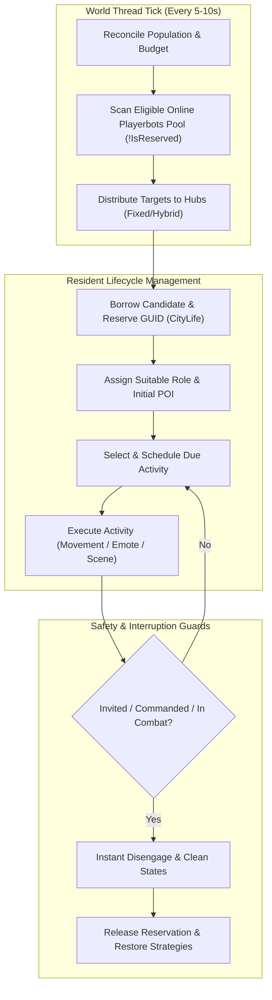
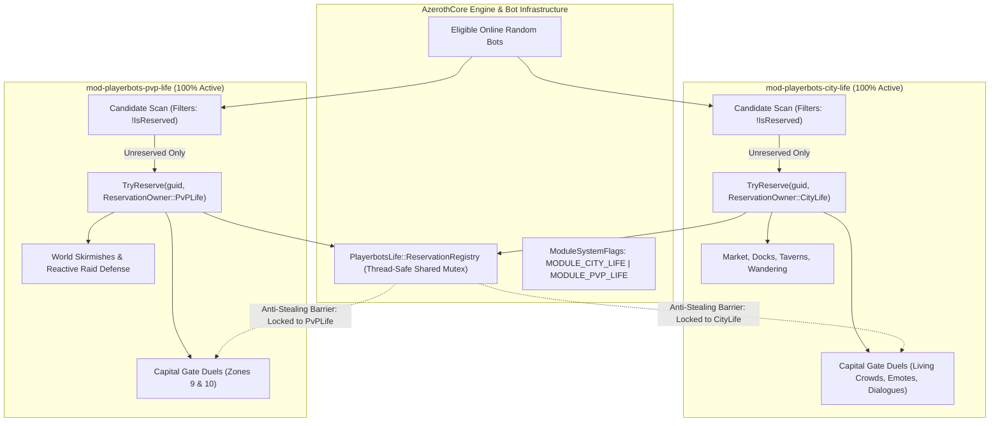
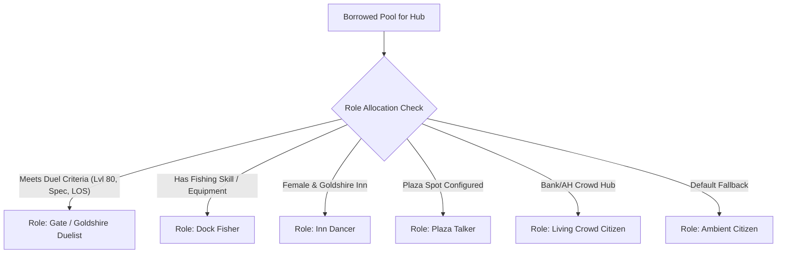
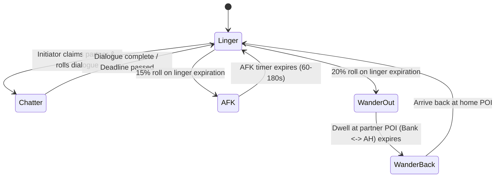

# Integrate mod-city-bots into Playerbots City Life

## 1. Summary and agreed defaults

Extend `mod-playerbots-city-life` as the authoritative module, retaining its population manager, hub and hotspot system, time-of-day scaling, shared reservations, and existing GM commands.

The integrated module will:

- Borrow existing online playerbots exclusively. It will not import the dedicated account, character creation, or login system.
- Enable imported non-economic activities wherever compatible bots and locations exist.
- Keep real purchasing, player trading, and unrestricted chatter disabled by default.
- Provide independent activity switches and runtime configuration reload where safe.
- Reuse and consolidate the existing `mod-city-bots` activity logic into one unified execution path.
- Preserve existing dedicated-roster database records while requiring the original `mod-city-bots` controller to be disabled.
- Guarantee world-thread safety: zero blocking I/O, zero cross-tick raw pointer storage (track via GUIDs and resolve freshly via `ObjectAccessor::FindPlayer`), and idempotent MySQL migrations.
- **Cross-Module Harmony:** Coexist seamlessly with `mod-playerbots-pvp-life` with zero feature suppression (all features in both modules run concurrently, including capital gate duels outside cities), candidate scanning isolation, and a thread-safe mutual anti-stealing reservation barrier.

Delivery is **source changes, configuration, migrations, documentation, and static verification**. Compilation, installation, live database changes, and server restart are outside the selected delivery scope.

---

## 2. Architecture and population management

### One manager and one activity controller

Keep `CityLife::Manager` responsible for borrowing, allocation, release, and population reconciliation. Extend its resident state with role, activity, timing, movement, conversation, and duel information.

Introduce module-local interfaces for:

- **Population snapshots:** eligible online bot GUIDs and cached eligibility information.
- **Population targets:** requested, time-scaled, demand-adjusted, and achievable counts per hub.
- **Activity state:** one active activity per resident, with GUID-based partner and target references.
- **Movement requests:** one shared path for relocation, activity travel, leash recovery, and return.
- **Cleanup reasons:** population reduction, owner takeover, invitation, logout, unavailable bot, disabled feature, reload, and shutdown.

Import the proven movement, duel, conversation, fishing, dancing, and social routines from `mod-city-bots`. Extract shared behavior from its action and direct-drive implementations into single reusable implementations. Do not register its parallel strategy sweeps, roster drivers, private-access helpers, or separate login manager.

Native Playerbots combat, security, and supported interaction actions remain authoritative. City Life controls ambient movement and activity selection while holding its reservation.



### Preserve existing behavior

Retain:

- Existing hub names, faction and level restrictions.
- Weighted hotspot selection, placement offsets, and stationary service residents.
- Time-of-day multipliers and per-hub `TimeScaling`.
- Residence durations, gradual arrivals and departures, and return-on-release behavior.
- Wintergrasp protections and faction-specific reservations.
- Existing `.citylife status`, `reload`, `hub`, and `spot` commands.

Existing installations without the new population settings retain the original exact-count allocation behavior. The updated distribution configuration explicitly selects the new profile.

### Configurable population profile

Use separate settings for budget, demand, and distribution so fixed counts and percentages can each work with dynamic demand. In a multi-module environment running alongside `mod-playerbots-pvp-life`, conservative default budgets (e.g. 12% / 150 bots each) prevent bot pool exhaustion and guarantee that plenty of unreserved random bots remain in the open world.

| Setting | New distribution default | Behavior |
|---|---:|---|
| `CityLife.Population.BudgetMode` | `percentage` | Select `count` or `percentage` |
| `CityLife.Population.FixedCount` | `150` | Requested budget in count mode (conservative multi-module ceiling) |
| `CityLife.Population.BorrowPercent` | `12` | Percentage of the eligible pool (leaves ample bots for PvP and open world) |
| `CityLife.Population.MaxTotal` | `150` | Hard global ceiling across all city hubs |
| `CityLife.Population.DemandMode` | `hybrid` | Select `fixed`, `dynamic`, or `hybrid` |
| `CityLife.Population.Distribution` | `scaled` | Select scaled hub shares or legacy counts |
| `CityLife.Population.BaselinePercent` | `20` | Empty-hub baseline in hybrid mode |
| `CityLife.Population.BurstGraceSeconds` | `180` | Delay before reducing an unattended hub |
| `CityLife.Population.MaxChangesPerTick` | Existing value | Limit ordinary borrowing and releases |

Define the percentage denominator as:

```text
eligible pool = eligible unassigned bots + valid City Life residents
```

Include managed residents during module-owned activities so fishing, conversations, and duels do not cause the denominator to shrink.

Exclude real players, player-owned bots, incompatible sessions, protected Wintergrasp bots, unavailable bots, and bots reserved by another activity module (including `mod-playerbots-pvp-life`).

Calculate the borrowing budget as:

```text
requested = FixedCount
         or floor(eligible pool × BorrowPercent / 100)

budget = min(requested, MaxTotal, eligible pool)
```

Demand modes:

- **Fixed:** request each hub’s full allocation, subject to its existing time scaling.
- **Dynamic:** populate attended hubs; retain explicitly configured fixed populations.
- **Hybrid:** retain a smaller baseline and increase attended hubs toward their full allocation, with departure grace.

In scaled distribution, existing hub populations become relative shares. Preserve priorities, add per-hub minimum and maximum settings, and use deterministic integer allocation. Apply time scaling and attendance reduction after calculating nominal shares; do not normalize away the nighttime reduction.

Preserve explicit fixed populations, including Wintergrasp’s existing configuration, within the global ceiling. Report shortages instead of exceeding the cap or borrowing unsuitable bots.

### Performance and borrowing safety

- Build one cached GUID census per reconciliation interval instead of scanning players for every assignment.
- Cache account eligibility using asynchronous database reads or startup indexed caches.
- Index residents by GUID and maintain hub counts incrementally.
- Index POIs and nearby participants by hub and map.
- Schedule only due activities, with jitter and configurable work limits.
- Bound resident updates, pathfinding calls, retries, diagnostics, and callback queues.
- Store no engine-object pointers across ticks or asynchronous operations.
- Revalidate eligibility immediately before borrowing and before executing an activity.

Reuse the existing `PlayerbotsLife` reservation registry without changing its public contract or importing a competing registry.

---

## 2.6 Cross-Module Coexistence Architecture with `mod-playerbots-pvp-life`

### Core Philosophy: Zero Feature Suppression & Autonomous Dual Execution

When running alongside `mod-playerbots-pvp-life`, `mod-playerbots-city-life` operates with **zero feature suppression**:
- **Neither module disables or cripples any feature or configuration token in order for the other to function.**
- **Both modules are fully enabled to run duels outside the city (capital gates)**: City Life executes its living crowd spectacles, dialogues, standoff rendezvous (`ComputeDuelMeetPoint`), and arbiter calls outside Stormwind Gate and Orgrimmar Gate; PvP Life executes its persistent capital duel zones (Zones 9 & 10) in the same regions. Each module controls only its own reserved bots.
- **The Sole Compatibility Layer**: Coexistence is enforced strictly through:
  1. **Candidate Scanning Isolation**: During bot selection, City Life scans the eligible bot pool and verifies that candidate bots are not already reserved by another module (`!PlayerbotsLife::IsReserved(guid)`). Any bot marked with `ReservationOwner::PvPLife` is strictly skipped.
  2. **Thread-Safe Anti-Stealing Reservation Barrier**: Once reserved by City Life (`ReservationOwner::CityLife`), a bot cannot be borrowed, moved, teleported, or drafted by PvP Life.
  3. **Module System Flags**: Process-wide atomic bitflags (`ModuleSystemFlags`) communicate which modules are active in memory.
  4. **Conservative Balanced Population Budgets**: Default borrowing limits in both modules are tuned conservatively (12% / 150 bots each) so both modules run at full capacity simultaneously without starving the shared random bot pool.



### Thread-Safe Shared Reservation Infrastructure: `LifeBotReservation.h`

`mod-playerbots-city-life` maintains the unified `PlayerbotsLife::ReservationRegistry`:

```cpp
#ifndef LIFE_BOT_RESERVATION_H
#define LIFE_BOT_RESERVATION_H

#include <atomic>
#include <cstdint>
#include <mutex>
#include <unordered_map>

namespace PlayerbotsLife
{
    enum class ReservationOwner : std::uint8_t
    {
        CityLife,
        PvPLife,
        Artisans
    };

    enum ModuleSystemFlags : std::uint32_t
    {
        MODULE_NONE       = 0x00,
        MODULE_CITY_LIFE  = 0x01,
        MODULE_PVP_LIFE   = 0x02,
        MODULE_ARTISANS   = 0x04
    };

    struct ReservationRegistry
    {
        std::mutex Mutex;
        std::unordered_map<std::uint32_t, ReservationOwner> Owners;
        std::atomic<std::uint32_t> ActiveModules{MODULE_NONE};
    };

    inline ReservationRegistry& GetReservationRegistry()
    {
        static ReservationRegistry registry;
        return registry;
    }

    inline void RegisterActiveModule(ModuleSystemFlags flag)
    {
        ReservationRegistry& registry = GetReservationRegistry();
        registry.ActiveModules.fetch_or(static_cast<std::uint32_t>(flag));
    }

    inline void UnregisterActiveModule(ModuleSystemFlags flag)
    {
        ReservationRegistry& registry = GetReservationRegistry();
        registry.ActiveModules.fetch_and(~static_cast<std::uint32_t>(flag));
    }

    inline bool IsModuleActive(ModuleSystemFlags flag)
    {
        ReservationRegistry& registry = GetReservationRegistry();
        return (registry.ActiveModules.load() & static_cast<std::uint32_t>(flag)) != 0;
    }

    inline std::uint32_t GetActiveModules()
    {
        return GetReservationRegistry().ActiveModules.load();
    }

    inline bool IsReserved(std::uint32_t guidLow)
    {
        ReservationRegistry& registry = GetReservationRegistry();
        std::lock_guard<std::mutex> lock(registry.Mutex);
        return registry.Owners.find(guidLow) != registry.Owners.end();
    }

    inline bool IsReservedBy(std::uint32_t guidLow, ReservationOwner owner)
    {
        ReservationRegistry& registry = GetReservationRegistry();
        std::lock_guard<std::mutex> lock(registry.Mutex);
        auto const entry = registry.Owners.find(guidLow);
        return entry != registry.Owners.end() && entry->second == owner;
    }

    inline bool TryReserve(std::uint32_t guidLow, ReservationOwner owner)
    {
        ReservationRegistry& registry = GetReservationRegistry();
        std::lock_guard<std::mutex> lock(registry.Mutex);
        auto const [entry, inserted] = registry.Owners.emplace(guidLow, owner);
        return inserted || entry->second == owner;
    }

    inline void Release(std::uint32_t guidLow, ReservationOwner owner)
    {
        ReservationRegistry& registry = GetReservationRegistry();
        std::lock_guard<std::mutex> lock(registry.Mutex);
        auto const entry = registry.Owners.find(guidLow);
        if (entry != registry.Owners.end() && entry->second == owner)
            registry.Owners.erase(entry);
    }
}

#endif
```

1. **System Flags Lifecycle:** On startup, City Life calls `PlayerbotsLife::RegisterActiveModule(MODULE_CITY_LIFE)`. On shutdown, it calls `PlayerbotsLife::UnregisterActiveModule(MODULE_CITY_LIFE)`.
2. **Mutual Anti-Stealing Protection:** In `CityLifeMgr.cpp`, `ScanEligiblePool()` checks `PlayerbotsLife::IsReserved(guidLow)`. If a bot is reserved by `ReservationOwner::PvPLife`, City Life strictly ignores it.
3. **Sub-Microsecond World Thread Safety:** All lookups use non-blocking mutex locks that complete in nanoseconds, preserving the 50–100ms world tick invariant.

---

## 3. Complete activity and interaction integration

### Unified Activity Matrix

Provide `CityLife.Activities.<Activity>.Enable` for every activity below. Global switches are hard limits; per-hub overrides can further restrict them. Disabled or unavailable activities are removed from selection, and their residents fall back to suitable ambient behavior.

| Activity | Default | Category | Integrated behavior & execution specifics |
|---|---|---|---|
| Leave inn | Enabled | Movement | Travel from an inn dwell point into the local activity circuit |
| Return to inn | Enabled | Dwell | Return and dwell using existing inn POIs or bed locations |
| City roaming | Enabled | Roaming | Weighted movement through compatible commercial and outlying city districts |
| Wall walking | Enabled | Patrol | Patrol along city battlements and wall checkpoints (e.g. Stormwind Harbor walls, Orgrimmar Cleft walls) |
| Tavern sitting | Enabled | Social | Sit on chairs/benches or ground; dwell periods (30-120s); cheering in social hubs |
| Tavern drinking | Enabled | Visual | Visual drinking animation; drink item emote; tavern applause/cheers |
| Random emotes | Enabled | Visual | Reuse existing emote pools (wave, cheer, bow, laugh, point) with cooldowns |
| Auction-house visits | Enabled | Service | Navigate to AH, face auctioneer, trigger gossip interaction or browsing animation |
| Mailbox visits | Enabled | Service | Locate nearest `GAMEOBJECT_TYPE_MAILBOX`, approach, face, trigger mailbox opening interaction |
| Trainer visits | Enabled | Service | Approach class/profession trainer, face NPC, trigger inspection gossip packet |
| Food-vendor visits | Enabled | Service | Visual visit by default; purchasing separately gated via Playerbots `rpg buy` |
| Duel watching | Enabled | Spectator | Spectator movement around duel rings; sit/stand; cheer/applaud/laugh reactions to duel events |
| Fishing | Enabled | Profession | Casting behavior at dock/water POIs (Spell 7620); checks fishing skill/rod; channels cast; dismounts beforehand |
| Paired duelling | Enabled | Combat | Pairing, rendezvous, challenge (Spell 7266), combat strategy, recovery (full HP/mana), cooldown, and leash |
| Inn dancing | Enabled | Performance | Goldshire Lion's Pride Inn dance routines; face real players; greetings by name; NO item destruction |
| Plaza socializing | Enabled | Social | Facing nearby citizens, wave/cheer emotes, localized town shouts and small talk |
| Scripted conversations | Enabled | Dialogue | Paired exchanges in themed pools; initiator-claim protocol with deadline auto-release |
| Bank/AH crowd scenes | Enabled | Living Crowd | 4-phase state machine (Linger, AFK, Wander-out, Wander-back); real-player proximity awakening |
| AFK behavior | Enabled | State | Timed entry with real `<AFK>` player tag; stop chat/emotes; automatic flag clearance on release/logout |
| Mounted travel | Enabled | Transit | Mount outdoor journeys (>30yd) if bot knows a mount; dismount immediately upon arrival at target POI |
| Idle fallback | Enabled | Fallback | Safe dwell and subtle breathing/shifting behavior when no activity can run |
| Release cycle | Enabled | Lifecycle | Gradual departure/release of borrowed bots back to home positions; Playerbots retains login ownership |

Retain source activity weights and timing parameters, with documented City Life equivalents. Pick an activity’s duration once on entry rather than repeatedly rerolling its expiration.

---

### Roles and location suitability

Replace fixed GUID casting lists with automatic role selection from the borrowed pool. Support optional GUID preferences and per-hub role counts or percentages.

Preserve the source’s ambient, fisher, dancer, plaza talker, dueller, and crowd roles. Allocate specialized roles within each hub’s population target, then assign remaining residents to ambient activity:



- **Fishers**: Must already possess the required skill and suitable equipment (fishing rod). If not equipped, use harmless visual fishing animation without deleting or replacing primary weapons.
- **Mount users**: Must already know an appropriate mount spell.
- **Duellers**: Must satisfy faction, level (level 80 for Gate/Goldshire duelers), specialization, location, and opponent checks.
- **Equipment safety**: Equipment changes must use existing items and remain 100% reversible.
  - *Strict rule*: Do not automatically teach skills, create equipment, raise levels, or change talents.
  - *Strict rule*: Do NOT import any routine that destroys equipment (such as `DestroyItem` in the dancer routine). For dancing, maintain clothes or use safe visual aura/transmog tricks if configured, never deleting character items.

Import gate duel locations and add a separate level-80 Goldshire duel sub-hub. This allows the source’s duel behavior without changing the existing Goldshire hub’s level range.

Retain source support for eligible player duel challenges behind its own switch. Never movement-control, teleport, resurrect, or restore a real player through city-bot recovery routines.

---

### Paired Duelling Subsystem (`CITIZEN_DUEL`)

The duelling subsystem ports the state machine from `CbStrategyGate` and `CitizenDuelAction`:

1. **Rendezvous & Partner Pairing**:
   - Duelers seek an eligible opponent within their assigned duel ring (search radius 40 yd).
   - Validation rules: Same level (80), same map, alive, not in combat, not already in duel, not on ignore list, valid LOS.
   - Lock partner via GUID reference in `DuelState`.
2. **Challenge & Initialization**:
   - Both bots face each other, approach within 8–10 yd, and initiator casts Duel (Spell 7266).
   - Opponent bot automatically accepts duel opcode upon receiving request.
3. **Combat Execution**:
   - City Life temporality yields movement to Playerbots combat AI while maintaining the duel ring boundary leash.
   - If a duel partner flees beyond 35 yd, leash back or forfeit.
4. **Post-Duel Resolution & Recovery**:
   - Once duel ends (surrender/win), restore duelists to full health and full mana (matching `CbDuelBotUtil::EnsureLevel`).
   - Clear combat flags and prevent stray aggro.
   - Enter duel cooldown (`CityLife.Duels.CooldownSec`, default 45s) during which bots cheer, applaud, or sit.
   - Leash back to home duel ring center if displaced.
5. **Duel Spectators (`CITIZEN_WATCH_DUELS`)**:
   - Ambient bots within 25 yd of an active duel transition into watching state.
   - Gather in a semi-circle at 10–18 yd distance, face the fighters, sit or stand, and roll cheers/applause upon combat actions.

---

### Living-Crowd Scenes Subsystem (`CITIZEN_CROWD_SOCIAL`)

Import the full living-crowd architecture for capital bank and auction house squares (Stormwind Trade District and Orgrimmar Valley of Strength, extensible to Ironforge The Great Forge and Dalaran Eventide):



1. **Proximity Wake Gate**:
   - Crowd bots stand at their POIs cheaply.
   - Expensive scene logic (chatter, AFK transitions, wander transitions) runs ONLY when a real player is within `CityLife.Crowd.PlayerRadius` (default 60 yd).
   - If no player is near, citizens remain standing, clear any stray AFK tags, and consume negligible CPU.
2. **4-Phase State Machine**:
   - **`CROWD_LINGER`** (Base State): Stand within 3 yd of assigned bank/AH POI. Occasional one-shot emote. Eligible for conversation rolls. Dwell 20–90s.
   - **`CROWD_AFK`**: Bot applies real player AFK flag (`UNIT_FIELD_BYTES_2` toggle), stands completely still for 60–180s (`CrowdAfkMinSec` to `CrowdAfkMaxSec`), stops emoting. Clears AFK flag upon exit.
   - **`CROWD_WANDER_OUT`**: Selects paired partner POI (e.g. Stormwind Bank POI #26 -> Stormwind AH POI #2; Orgrimmar Bank POI #136 -> Orgrimmar AH POI #102). Walks over, dwells 30–120s.
   - **`CROWD_WANDER_BACK`**: Walks back to home bank/AH POI and transitions to `CROWD_LINGER`.
3. **Bot-to-Bot Chatter Protocol**:
   - Canned themed dialogue tables (Bank lines, AH bargain lines, Plaza banter).
   - Initiator scans for unclaimed partner within 15 yd in `CROWD_LINGER`.
   - Initiator claims partner: sets `chatPartner` GUID, `chatDialogueId`, and `chatDeadlineMs` (now + 45s slack) on both residents.
   - Initiator delivers Line 1 -> waits 3–6s -> commands partner to deliver Line 2 -> optional Line 3.
   - Releases claim on both sides and places both on `CrowdChatCooldownSec` (default 90s).
   - Safe deadline cleanup: If either partner leaves or scene sleeps, deadline expires and self-releases without stalled claims.

---

### Navigation, Mounting & Sink Forensics Subsystem

Route all ambient movement through the consolidated movement engine:

1. **District-Aware Routing**:
   - Alternating visits between commerce/social hubs and outlying districts.
   - Weighted selection using `city_life_spot` weights.
2. **Mounted Transit (`CityLife.Movement.MountBetweenPoiChance`)**:
   - For outdoor movement legs exceeding 30 yd: 90% chance to mount if bot has learned an appropriate mount.
   - Immediate dismount upon arrival (`DismountIfMounted`) before initiating sitting, emoting, or interaction.
3. **Multi-Tier Floor & Sink Forensics**:
   - **`LowestPoiZWithin`**: Finds lowest curated Z among POIs within 2D radius. Prevents bots on lower tiers of multi-level cities (e.g. Undercity lower tier at -62 vs upper at -43, Ironforge Tinker Town, Dalaran Sewers) from being falsely flagged as falling through terrain.
   - **`SinkForensics`**: Tracks bot Z delta across ticks. If Z drops > 8 yd without teleport into water or void, flags diagnostic event.
   - **Floor-Height and Navmesh Verification**: All movement destinations must pass standard AzerothCore mmaps (`GetMMapManager`) dry-ground height validation.
   - **Stalled Journey Recovery**: Detect stalled routes (`PathRefuseStreak` > 3); retry with intermediate waypoint or safely teleport to nearest anchor spot.

---

### Safe and source-equivalent interaction profiles

Add these independent controls:

```ini
CityLife.Interactions.Enable = 0
CityLife.Interactions.PlayerTrading = 0
CityLife.Interactions.BuyFood = 0

CityLife.Chat.ScriptedConversations = 1
CityLife.Chat.Greetings = 1
CityLife.Chat.Unrestricted = 0
CityLife.Chat.RandomSayChance = 0

CityLife.Achievements.BlockAchievements = 1
```

With interactions disabled:
- Service visits remain visual (facing and gossip packet) and cannot initiate economic activity.
- Trade attempts with borrowed bots are rejected cleanly.

With interactions enabled:
- Food purchasing invokes the existing Playerbots `rpg buy` action.
- Player trading uses existing Playerbots trade handling.
- `AiPlayerbot.EnableRandomBotTrading` remains authoritative:
  - Mode 0: No trading. Whispers `trade_disabled` localization string.
  - Mode 1: Full trading.
  - Mode 2: Bot only buys (bot cannot place items into trade slots).
  - Mode 3: Bot only sells (player cannot give items to bot).
  - Non-traded enchant slot (`TRADE_SLOT_NONTRADED`) is preserved and never blocked, permitting enchanting and item inspection.
- Recheck settings during an open trade; disabling trading cancels affected sessions safely.
- `BlockAchievements`: When enabled, hooks `OnPlayerBeforeAchievementComplete` and `OnPlayerBeforeCriteriaProgress` to prevent borrowed bots from claiming realm-first achievements or cluttering achievement database tables.

Document an **Option 2 supported-interactions profile** that enables these settings through configuration reload without recompilation.

---

### Cleanup and coexistence

- Use one cleanup path to release conversation and duel claims, clear module-owned AFK/emote states, restore temporary equipment and strategy changes, and release reservations.
- **Instant Disengagement**: Disengage instantly on group invitation (`OnGroupInvite`) or authorized owner control (`HasGameClientMaster`). Do not return-teleport a bot away from its new owner or group.
- **Coexistence Detection**: Detect simultaneous activation of the original `mod-city-bots` controller and refuse conflicting City Life activation with an actionable diagnostic. Preserve existing dedicated accounts, characters, and roster records; exclude them from borrowing.

---

## 4. Configuration, data, and complete debugging

### Configuration reference (`mod_playerbots_city_life.conf.dist`)

Add all new settings to the existing configuration file under `[worldserver]`, organized into logical blocks:

```ini
###################################################################################################
# Population & Demand Settings
###################################################################################################
CityLife.Population.BudgetMode = "percentage"     # "count" or "percentage"
CityLife.Population.FixedCount = 150              # Budget when BudgetMode is "count" (multi-module tuned)
CityLife.Population.BorrowPercent = 12            # Percentage of eligible pool (leaves ample bots for PvP)
CityLife.Population.MaxTotal = 150                # Absolute ceiling across all city hubs
CityLife.Population.DemandMode = "hybrid"         # "fixed", "dynamic", or "hybrid"
CityLife.Population.Distribution = "scaled"       # "scaled" or "legacy"
CityLife.Population.BaselinePercent = 20          # Minimum baseline percentage in hybrid mode
CityLife.Population.BurstGraceSeconds = 180       # Seconds before reducing an unattended hub

###################################################################################################
# Compatibility & Coexistence with mod-playerbots-pvp-life
###################################################################################################
CityLife.Compatibility.PvPLife.EnableHarmony = 1       # Master switch for coexistence with PvP Life
CityLife.Compatibility.PvPLife.RespectReservations = 1 # Never borrow bots reserved by PvP Life

###################################################################################################
# Activities Master & Subsystem Toggles
###################################################################################################
CityLife.Activities.LeaveInn.Enable = 1
CityLife.Activities.ReturnToInn.Enable = 1
CityLife.Activities.Roaming.Enable = 1
CityLife.Activities.WallWalking.Enable = 1
CityLife.Activities.TavernSitting.Enable = 1
CityLife.Activities.TavernDrinking.Enable = 1
CityLife.Activities.RandomEmotes.Enable = 1
CityLife.Activities.AuctionHouse.Enable = 1
CityLife.Activities.Mailbox.Enable = 1
CityLife.Activities.Trainer.Enable = 1
CityLife.Activities.FoodVendor.Enable = 1
CityLife.Activities.DuelWatching.Enable = 1
CityLife.Activities.Fishing.Enable = 1
CityLife.Activities.Duels.Enable = 1
CityLife.Activities.InnDancing.Enable = 1
CityLife.Activities.PlazaSocial.Enable = 1
CityLife.Activities.CrowdScenes.Enable = 1
CityLife.Activities.MountedTravel.Enable = 1

###################################################################################################
# Living Crowd Scenes (Bank & Auction House Squares)
###################################################################################################
CityLife.Crowd.Enable = 1
CityLife.Crowd.PlayerRadius = 60                  # Proximity check distance in yards
CityLife.Crowd.ChatCooldownSec = 90               # Cooldown between conversation exchanges
CityLife.Crowd.AfkMinSec = 60                     # Minimum duration of AFK phase
CityLife.Crowd.AfkMaxSec = 180                    # Maximum duration of AFK phase

###################################################################################################
# Duelling Subsystem
###################################################################################################
CityLife.Duels.CooldownSec = 45                   # Cooldown between duels per bot
CityLife.Duels.AllowPlayerChallenge = 1           # Allow real players to challenge duelers
CityLife.Duels.MaxDuelDistance = 40.0             # Radius around duel ring

###################################################################################################
# Movement & Navmesh Safety
###################################################################################################
CityLife.Movement.MountBetweenPoiChance = 90      # Chance to mount on long outdoor journeys
CityLife.Movement.SinkForensics = 1               # Log warnings if bot falls through terrain
CityLife.Movement.MaxPathRefuseStreak = 3         # Retries before safe recovery teleport

###################################################################################################
# Chat & Interactions Safety
###################################################################################################
CityLife.Chat.ScriptedConversations = 1
CityLife.Chat.Greetings = 1
CityLife.Chat.Unrestricted = 0
CityLife.Chat.RandomSayChance = 0
CityLife.Chat.SayCooldownSec = 30

CityLife.Interactions.Enable = 0
CityLife.Interactions.PlayerTrading = 0
CityLife.Interactions.BuyFood = 0
CityLife.Achievements.BlockAchievements = 1
```

Runtime reload rules:
- `.reload config` refreshes cached configuration through existing hooks.
- `.citylife reload` retains its hub/spot data-reload purpose.
- Apply configuration and data snapshots at safe update boundaries.
- Preserve valid residents and avoid restarting the startup delay on ordinary reload.
- Disabling an activity cleans its active state before selecting a fallback.
- Disabling the module releases residents safely.
- Reject invalid reload data without replacing the last valid snapshot.
- Missing optional activity metadata disables affected activities while retaining basic City Life.

---

### Database additions and schema migration

Prepare an additive, idempotent WORLD migration in `data/sql/world/updates/2026_10_10_01_city_life_extended_pois.sql`.

1. **Extend `city_life_spot` Schema**:
   Add columns if they do not exist, ensuring backward compatibility:
   - `poi_type`: `TINYINT UNSIGNED NOT NULL DEFAULT 7` (Maps to `CityPoiType`: 0=Inn, 1=AH, 2=Mailbox, 3=Tavern, 4=Trainer, 5=Dock, 6=WallPatrol, 7=Plaza, 8=Vendor, 9=DuelRing, 10=InnBed, 11=Bank).
   - `district`: `VARCHAR(32) NOT NULL DEFAULT ''`.
   - `partner_spot_id`: `INT UNSIGNED NOT NULL DEFAULT 0` (Used for Bank <-> AH crowd transitions).

   ```sql
   ALTER TABLE `city_life_spot`
       ADD COLUMN IF NOT EXISTS `poi_type` TINYINT UNSIGNED NOT NULL DEFAULT 7 COMMENT '0=Inn,1=AH,2=Mailbox,3=Tavern,4=Trainer,5=Dock,6=WallPatrol,7=Plaza,8=Vendor,9=DuelRing,10=InnBed,11=Bank' AFTER `category`,
       ADD COLUMN IF NOT EXISTS `district` VARCHAR(32) NOT NULL DEFAULT '' AFTER `poi_type`,
       ADD COLUMN IF NOT EXISTS `partner_spot_id` INT UNSIGNED NOT NULL DEFAULT 0 AFTER `district`;
   ```

2. **Idempotent Spot & Hub Seeding**:
   - Import all 240+ curated POIs from `mod-city-bots` (`city_bot_poi`), mapping each location key to the corresponding `city_life_hub` ID.
   - Seed new duel sub-hubs: `StormwindGate`, `OrgrimmarGate`, and `GoldshireDuel`.
   - Protect existing custom spots and user coordinates using `INSERT IGNORE` or `ON DUPLICATE KEY UPDATE`.
   - Never run replacement logic that deletes existing user spots.

3. **Optional Guard Ambience Pack**:
   - Provide `data/sql/world/optional/2026_10_10_02_city_life_guard_ambience.sql`.
   - Uses standard SmartAI to make city gate guards salute, nod, or patrol.
   - Completely opt-in, documented, and removable without affecting core City Life.

---

### Debugging coverage and GM tools

Expand `CityLife.Debug` across the entire module while preserving its existing master-switch behavior.

Add subsystem filtering for:
- Configuration and reload.
- Database and POI validation.
- Eligibility and exclusion reasons.
- Budget calculations and hub allocation.
- Reservations, anti-stealing barrier, and owner takeover.
- Role and activity selection.
- Movement, mounting, path rejection, and recovery.
- Fishing and equipment restoration.
- Duels and partner claims.
- Conversations, AFK, and crowd phases.
- Trading and purchasing decisions.
- Cleanup, shutdown, and performance.

Include GUID, hub, role, activity, decision reason, and relevant targets in diagnostic events. Use existing AzerothCore logging facilities with bounded, throttled output.

Extend GM diagnostics with:

```text
.citylife status [hub]
.citylife compat
.citylife debug status
.citylife debug bot <guid|name>
.citylife debug hub <name>
.citylife debug validate
.citylife debug trace <guid|name> [seconds]
.citylife debug counters
.citylife test duel <guid1> <guid2>
.citylife test crowd <hub>
```

Status must distinguish requested population, effective budget, achievable targets, residents, shortages, and baseline/burst state. Bot inspection must explain unavailable activities and eligibility failures.

Keep bounded recent-event history for troubleshooting. Clean diagnostic state when residents leave.

---

## 5. Verification and delivery criteria

### Source-feature coverage matrix

| Source Feature (`mod-city-bots`) | Destination Component (`mod-playerbots-city-life`) | Configuration Toggle | Adaptation / Protection Notes | Verification Scenario |
|---|---|---|---|---|
| Dedicated Accounts & Login Mgr | Excluded | N/A | Exclusively borrow online random bots | Scenario 2, 3 |
| City Roaming & District Nav | `CityLifeMovement` | `Activities.Roaming.Enable` | Alternating commercial / outlying districts | Scenario 10 |
| Living Crowd Scenes (Bank/AH) | `CityLifeActivities` | `Activities.CrowdScenes.Enable` | 4-phase state machine + proximity wake | Scenario 8, 18 |
| Paired Duelling & Duel Watching | `CityLifeActivities` | `Activities.Duels.Enable` | Lvl 80 check, HP/mana restore, ring leash; runs concurrently with PvP Life | Scenario 7, 19, 28 |
| Fishing at Docks | `CityLifeActivities` | `Activities.Fishing.Enable` | Requires rod/skill; no weapon destruction | Scenario 9, 20 |
| Inn Dancing & Plaza Social | `CityLifeActivities` | `Activities.InnDancing.Enable` | NO item destruction; greetings by name | Scenario 9, 21 |
| Mounted Travel | `CityLifeMovement` | `Activities.MountedTravel.Enable` | Mount outdoors >30yd; dismount on arrival | Scenario 10, 22 |
| Sink Forensics & Multi-Tier Z | `CityLifeMovement` | `Movement.SinkForensics` | `LowestPoiZWithin` floor protection | Scenario 10, 23 |
| Trade Interception & Economy | `CityLifeInteractions` | `Interactions.Enable`, `PlayerTrading` | Enforces modes 0-3; enchant slot exempt | Scenario 11, 12, 13 |
| Achievement Shielding | `CityLifeInteractions` | `Achievements.BlockAchievements` | Blocks realm-firsts for ambient bots | Scenario 24 |
| Group Invite Disengage | `CityLifeMgr` | Always Active | Instant release, zero return-teleport | Scenario 14 |
| Coexistence Check | `CityLifeMgr` | Always Active | Refuses activation if `mod-city-bots` active | Scenario 15 |
| Shared Reservation & Anti-Stealing | `LifeBotReservation.h` | `Compatibility.PvPLife.EnableHarmony` | Thread-safe mutex registry; system flags; never borrows PvP bots | Scenario 26, 27 |
| Idempotent POI Schema | `data/sql/world/updates/` | N/A | Additive columns; preserves custom spots | Scenario 16, 25 |

### Comprehensive Verification Scenarios

1. **Legacy Compatibility**: Legacy configuration preserves existing population, time scaling, hotspot distribution, Wintergrasp behavior, and GM commands.
2. **Stable Accounting**: Percentage accounting remains stable when bots become residents or enter module-owned activities (denominator does not shrink).
3. **Demand Profiles**: Fixed, dynamic, and hybrid profiles handle small and large pools, shortages, faction imbalance, and cap reductions deterministically.
4. **Baseline & Burst Transitions**: Baseline/burst transitions respect real-player presence and `BurstGraceSeconds` grace periods.
5. **Activity Eligibility**: Every activity runs only with compatible bots and POIs; unavailable activities fall back cleanly with debug diagnostics.
6. **Independent Toggles**: Every activity toggle works independently, including runtime reload while an activity is executing.
7. **Paired Duels**: Duel pairing prevents duplicate claims and handles timeout, combat, departure, spectator reactions, and opponent loss.
8. **Crowd Chatter Safety**: Conversation claims expire and clean both participants; chatter does not cascade; scene sleeps when no player is near.
9. **State & Equipment Restoration**: AFK tags, sitting postures, and temporary states are restored on every release path; zero inventory loss.
10. **Navigation & Sink Protection**: Movement handles missing paths, canals, multilevel cities (Undercity/Dalaran/Ironforge), stalled journeys, and mounted arrival without competing controllers.
11. **Safe Economic Defaults**: Safe defaults initiate zero gold, trade, or inventory transactions.
12. **Trading Modes Enforcement**: Enabled interactions use existing actions and honor trading modes `0–3` plus Playerbots security restrictions.
13. **Reload During Trade**: Reloading interaction settings during trade cancels or secures active sessions safely.
14. **Instant Group Disengage**: Group invitation and owner control stop ambient activity instantly without teleporting the bot away.
15. **Coexistence Guard**: Legacy-controller activation is detected; dedicated roster data remains untouched; clear diagnostics emitted.
16. **Database Idempotency**: WORLD migrations support fresh installation and repeated upgrades without duplicate keys or replacing custom data.
17. **Bounded Diagnostics**: Diagnostics cover every subsystem and remain bounded under heavy population.
18. **Crowd Proximity Awakening**: Crowd scene stays asleep (0 CPU chatter) until real player is <= 60 yd; wakes up and delivers natural dialogue.
19. **Duel Recovery**: Duelists are restored to 100% HP and mana immediately upon duel completion, enter cooldown, and return to ring.
20. **Harmless Fishing**: Fishers cast fishing line at docks without deleting their mainhand/offhand weapons.
21. **Dance Routine Safety**: Inn dancers perform greetings and dance animations without destroying or deleting character inventory.
22. **Mounted Arrival Handling**: Bots mount when traveling outdoor distances > 30 yd and dismount cleanly before emoting or interacting at destination.
23. **Multi-Level City Floor Check**: Bots on lower tiers of Undercity (-62) and Dalaran sewers do not trigger sink forensics or erroneous floor teleports.
24. **Achievement Shielding**: Borrowed ambient bots do not complete realm-first achievements or spam criteria progress tables when blocked.
25. **MySQL Migration Execution**: Verified clean execution against a populated AzerothCore MySQL database with zero errors or schema corruption.
26. **Dual-Module Startup & System Flags:** Run both `mod-playerbots-city-life` and `mod-playerbots-pvp-life`; verify clean initialization, atomic registration of `MODULE_CITY_LIFE` and `MODULE_PVP_LIFE`, and output of `.citylife compat`.
27. **Bot Candidate Anti-Stealing Barrier:** Verify City Life's `ScanEligiblePool()` checks `IsReserved()` and strictly skips any bot marked with `ReservationOwner::PvPLife`, never interrupting PvP skirmishes, campaigns, or reactive defense.
28. **Concurrent Capital Gate Duels:** Verify City Life and PvP Life run duels outside Stormwind and Orgrimmar gates simultaneously; verify City Life pairs only its own reserved bots for crowd rituals without interference from PvP Life duelers.
29. **Conservative Multi-Module Budget Pool Stability:** Verify that under default conservative budgets (12% City Life, 12% PvP Life), the server maintains ≥ 76% of eligible random bots for general world questing and dungeon activity without bot pool starvation.
30. **Dynamic Hot-Reload Harmony:** Execute `.reload config` while both modules are actively running; verify compatibility and activity settings reload cleanly without interrupting city residents or PvP combatants.
31. **Standalone Operation Integrity:** Unload `mod-playerbots-pvp-life`; verify `mod-playerbots-city-life` runs standalone with full reservation and activity stability.

For the selected source-only delivery, perform configuration consistency, source/API, wiring, SQL safety, ownership, threading, and diff checks. Prepare deterministic population regression cases and the MySQL-backed migration/runtime checklist.

Record compilation, MySQL execution, and in-game checks as pending until actually performed. Do not mark runtime issues resolved from static inspection.

Deliver the localized City Life changes, complete coverage matrix, safe/default and Option 2 configuration examples, migration instructions, expanded debugging guide, changelog, and verification record.
